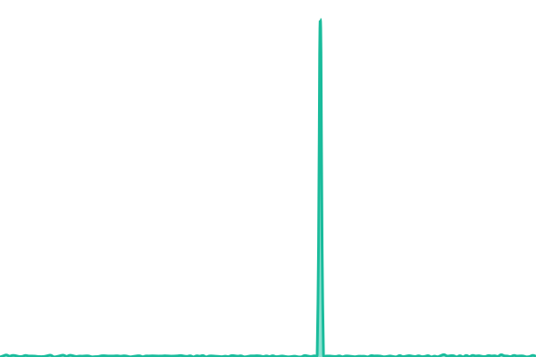
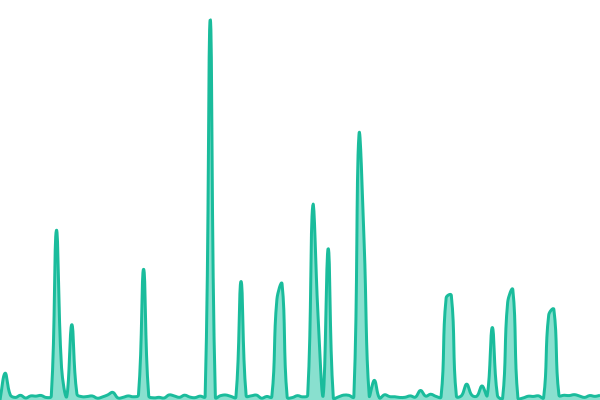

# [📈 Live Status](https://bacdoxuan.github.io/status): <!--live status--> **🟩 All systems operational**

This repository contains the open-source uptime monitor and status page for [Do Xuan Bac](https://www.linkedin.com/in/bacdoxuan/), powered by [Upptime](https://github.com/upptime/upptime).

With [Upptime](https://upptime.js.org), you can get your own unlimited and free uptime monitor and status page, powered entirely by a GitHub repository. We use [Issues](https://github.com/bacdoxuan/status/issues) as incident reports, [Actions](https://github.com/bacdoxuan/status/actions) as uptime monitors, and [Pages](https://bacdoxuan.github.io/status) for the status page.

<!--start: status pages-->
<!-- This summary is generated by Upptime (https://github.com/upptime/upptime) -->
<!-- Do not edit this manually, your changes will be overwritten -->
<!-- prettier-ignore -->
| URL | Status | History | Response Time | Uptime |
| --- | ------ | ------- | ------------- | ------ |
|  [Web App](https://simplemoneytracker.com) | 🟩 Up | [web-app.yml](https://github.com/bacdoxuan/status/commits/HEAD/history/web-app.yml) | 

 131ms
     
 | 

<a href="https://status.simplemoneytracker.com/history/web-app">100.00%</a>
    

|  [Login](https://simplemoneytracker.com/login) | 🟩 Up | [login.yml](https://github.com/bacdoxuan/status/commits/HEAD/history/login.yml) | 

 366ms
     
 | 

<a href="https://status.simplemoneytracker.com/history/login">100.00%</a>
    

|  [Telegram Bot](https://simplemoneytracker.com/api/telegram/webhook) | 🟩 Up | [telegram-bot.yml](https://github.com/bacdoxuan/status/commits/HEAD/history/telegram-bot.yml) | 

 1033ms
     
 | 

<a href="https://status.simplemoneytracker.com/history/telegram-bot">100.00%</a>
    

<!--end: status pages-->

[**Visit our status website →**](https://bacdoxuan.github.io/status)

## 📄 License

- Powered by: [Upptime](https://github.com/upptime/upptime)
- Code: [MIT](./LICENSE) © [Anand Chowdhary](https://anandchowdhary.com)
- Data in the `./history` directory: [Open Database License](https://opendatacommons.org/licenses/odbl/1-0/)
